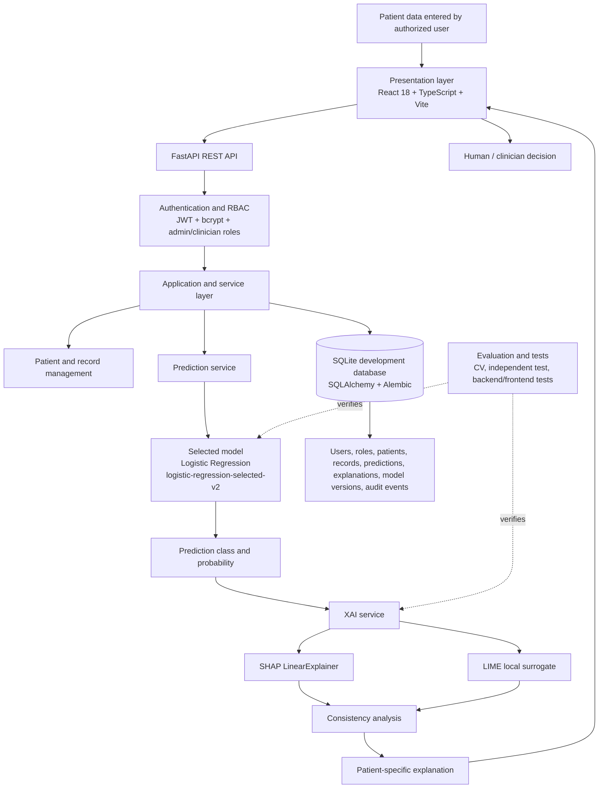
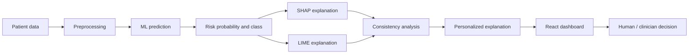

# Final System Architecture and Workflow

This document is the final architecture and workflow reference for the Explainable AI Personalized Clinical Decision Support System (XAI-CDSS). It describes the implemented research prototype and its documented limits. The system is a clinical decision-support system: it supports human review and does not autonomously diagnose disease or prescribe treatment.

## 1. System purpose and architecture at a glance

The prototype accepts a patient's diabetes-related measurements, applies the established machine-learning preprocessing pipeline, produces a diabetes class and probability, and explains that individual prediction with SHAP and LIME. The React dashboard presents the result to an authenticated user through the FastAPI API.



### Layer responsibilities

| Layer | Responsibility | Implemented elements |
|---|---|---|
| Presentation | Collect input and present predictions, explanations, loading/error states, and navigation | React 18, TypeScript, Vite, responsive CSS, React Router, Recharts |
| API/backend | Expose authenticated REST operations and validate requests | FastAPI routes for health, auth, patients, predictions, and explanations |
| Authentication/RBAC | Verify identity and restrict operations by role | JWT bearer tokens, bcrypt password verification, `admin` and `clinician` authorization |
| Application/services | Coordinate persistence, inference, explanations, and consistency checks | Prediction service, XAI service, route dependencies, SQLAlchemy sessions |
| ML | Preprocess features, compare fixed candidate models, and run the selected artifact | Pipeline preprocessing and `logistic-regression-selected-v2` |
| XAI | Produce local feature contributions and compare explanation methods | SHAP LinearExplainer, LIME, overlap/rank/direction metrics |
| Persistence | Store users, patient records, predictions, explanations, model metadata, and audit entities | SQLAlchemy models, SQLite local database, Alembic migrations |
| Evaluation/testing | Measure model behavior, reproducibility, API behavior, and UI regression | P5.1/P5.2 evaluation artifacts, pytest, Vitest, production build |

## 2. End-to-end system workflow



1. **Patient data:** An authorized admin or clinician creates a privacy-minimal patient code and a patient record containing the eight Pima input fields: Pregnancies, Glucose, BloodPressure, SkinThickness, Insulin, BMI, DiabetesPedigreeFunction, and Age.
2. **Preprocessing:** The shared pipeline treats zero-coded Glucose, BloodPressure, SkinThickness, Insulin, and BMI values as missing. Pregnancies equal to zero remains valid. Median imputation and scaling are fitted inside the model pipeline using training data.
3. **ML prediction:** The prediction service loads the frozen serialized pipeline and does not train during an API request.
4. **Risk probability/class:** The service returns a binary predicted class and a model probability for the positive class. This probability is a model output, not a clinically calibrated risk percentage.
5. **SHAP + LIME:** SHAP attributes the selected Logistic Regression model's raw log-odds output to the eight features. LIME fits a local surrogate around the input and reports explanation weights.
6. **Consistency analysis:** The service compares the two local explanations using top-feature overlap, rank correlation, and direction agreement. These metrics describe the evaluated case only.
7. **Personalized explanation:** The explanation retains the individual's entered feature values and the direction and size of their model contributions. Personalization means the explanation is tied to that record; it does not mean personalized treatment.
8. **Dashboard:** The frontend displays the prediction, SHAP view, LIME view, and consistency result through the authenticated API.
9. **Human decision:** A qualified human interprets the output with other appropriate information. The prototype does not make an autonomous diagnosis or treatment recommendation.

## 3. Machine-learning workflow

### Dataset and features

The project uses the Pima Indians Diabetes Dataset: 768 rows, eight input features, and the binary `Outcome` target. The feature order is fixed as follows:

`Pregnancies`, `Glucose`, `BloodPressure`, `SkinThickness`, `Insulin`, `BMI`, `DiabetesPedigreeFunction`, `Age`.

### Preprocessing and separation

The data is split before fitted preprocessing. The established protocol uses an 80/20 stratified split with `random_state=42`. The training partition is used for five-fold model selection; the independent partition is reserved for final descriptive evaluation. Zero-coded medical measurements are mapped to missing according to the existing project rule, while Pregnancies zero is retained. Median imputation and `StandardScaler` are inside the appropriate pipeline so fold validation data does not fit preprocessing statistics.

### Model comparison and selection

The candidates are Logistic Regression, Random Forest, SVC, and XGBoost. Five-fold `StratifiedKFold` uses shuffle and `random_state=42`. No hyperparameter tuning was introduced in P5.2. The primary selection metric was the highest mean training-partition ROC-AUC. Secondary metrics were F1, recall, precision, and accuracy; tie-breaking would use lower ROC-AUC standard deviation, then higher F1 and recall.

The selected artifact is:

`ml/registry/logistic_regression_selected_v2.joblib` (`logistic-regression-selected-v2`).

The independent test set was not used to choose the model. P5.2 selected Logistic Regression because its training-only mean ROC-AUC was 0.8434 ± 0.0185, ahead of SVC, Random Forest, and XGBoost.

### Independent evaluation and calibration

After selection, the frozen Logistic Regression model's independent test measurements were accuracy 0.7078, precision 0.6000, recall 0.5000, F1 0.5455, and ROC-AUC 0.8130. The bootstrap 95% ROC-AUC interval was [0.7396, 0.8729]. The confusion matrix was TN=82, FP=18, FN=27, TP=27.

Calibration was assessed internally on that held-out split using a Brier score of 0.1754, actual positive rate 0.3506, and mean predicted probability 0.3515. This is an internal held-out assessment; it must not be described as clinical calibration.

P5.2 corrected the earlier model-selection problem by using training-only CV. The final artifact record also contains a literal test-reuse caveat: held-out calculations were rerun while finalizing result files. No selection or tuning decision used those rerun values, but future evaluation should treat that split as consumed.

### Reproducibility

The protocol records the random seed, dataset hash, feature order, split parameters, preprocessing rule, package versions, selected artifact hash, and model version. Repeated CV scores and repeated predictions for the fixed synthetic example were numerically identical in the recorded environment. Reproducibility does not imply clinical validity.

## 4. Explainable-AI workflow

Explainability is included so an authorized user can inspect which input features influenced a particular model output. It helps expose model behavior and supports review; it does not turn an association into a causal medical conclusion.

### SHAP

SHAP uses `LinearExplainer` for the selected Logistic Regression model. It returns one signed contribution for each of the eight input features. The contributions are checked against the model's raw decision-function output in log-odds space. They are not percentage-point changes in probability.

### LIME

LIME generates a local surrogate explanation using seed 42, 5,000 samples, and eight feature weights. LIME weights are surrogate explanation units, not probabilities. LIME and SHAP use different explanation constructions and scales.

### Consistency

For the one P5.2 synthetic case, top-3 overlap was 2/3, top-5 overlap was 4/5, Spearman correlation was 0.6429 with p=0.0856, and direction agreement was 7/8. This is a case-level demonstration. It is not evidence of global SHAP/LIME stability or trustworthiness.

Both explanation methods describe model behavior. They are not diagnoses, causal findings, treatment instructions, or evidence that a feature is medically changeable.

## 5. Personalization workflow

The system uses the values in the individual's record when generating the prediction and explanation. For example, that individual's glucose, BMI, age, pregnancies, blood pressure, insulin, skin thickness, and diabetes pedigree value are passed through the same frozen pipeline. Their combination can produce a different class, probability, and contribution ranking from another individual's combination. The explanation reports those patient-specific values and model directions; it does not invent medical recommendations or personalized treatment.

## 6. Backend architecture

FastAPI exposes the REST API and OpenAPI documentation. Route dependencies obtain a SQLAlchemy session, resolve the JWT subject to an active user, and enforce allowed roles. The service layer keeps inference and explanation logic separate from HTTP handlers:

- **Authentication:** `/auth/login` verifies the username, bcrypt hash, and active status; `/auth/me` returns safe current-user details.
- **RBAC:** role dependencies permit protected operations for the configured admin or clinician roles and reject insufficient roles.
- **Patient and record management:** routes create and retrieve privacy-minimal patient codes and the eight-field patient records.
- **Prediction service:** loads the frozen model pipeline, validates model metadata, predicts the class/probability, and persists a `Prediction` linked to the patient record and `ModelVersion`.
- **XAI service:** verifies that the saved prediction matches the current record/model, creates SHAP or LIME explanations, persists feature-level rows, and computes consistency metrics.
- **Database access:** SQLAlchemy 2.x manages ORM entities and sessions. Alembic tracks schema revisions. SQLite is the current local-development database; the model design remains compatible with a PostgreSQL-style deployment.
- **Audit logging:** `AuditLog` is a persisted entity for user-linked actions and target entities. The current model definition exists, but the project should not be described as having complete request middleware audit coverage.

The database entities are `Role`, `User`, `Patient`, `PatientRecord`, `Prediction`, `Explanation`, `ModelVersion`, and `AuditLog`.

## 7. Frontend architecture

The frontend uses React 18 with TypeScript and Vite. React Router defines guest, protected, dashboard, patients, patient-details, and record-details routes. The authentication context coordinates login and current-user state; the API client and service modules call the backend. The access token is currently held in browser `localStorage`.

The dashboard provides the clinician-oriented entry point. Patient pages list patients and open patient details. Record details submit or display the input record, request a prediction, and present SHAP, LIME, and consistency information. Recharts is available for data displays, and responsive CSS supports the local dashboard layout.

The implemented frontend flow is:

`Login → Dashboard → Patients → Patient Details → Patient Record → Prediction → SHAP → LIME → Consistency Analysis`.

## 8. Database and ER description

```mermaid
erDiagram
    ROLE ||--o{ USER : assigns
    USER ||--o{ AUDIT_LOG : creates
    PATIENT ||--o{ PATIENT_RECORD : has
    PATIENT ||--o{ PREDICTION : owns
    PATIENT_RECORD ||--o{ PREDICTION : receives
    MODEL_VERSION ||--o{ PREDICTION : produces
    PREDICTION ||--o{ EXPLANATION : has

    ROLE { integer id PK; string name; string description }
    USER { integer id PK; string username; string email; string password_hash; integer role_id FK; boolean is_active }
    PATIENT { integer id PK; string patient_code UK; datetime created_at; datetime updated_at }
    PATIENT_RECORD { integer id PK; integer patient_id FK; numeric pregnancies; numeric glucose; numeric blood_pressure; numeric skin_thickness; numeric insulin; numeric bmi; numeric diabetes_pedigree_function; numeric age; datetime created_at }
    PREDICTION { integer id PK; integer patient_id FK; integer patient_record_id FK; integer model_version_id FK; integer predicted_class; numeric predicted_probability; datetime created_at }
    EXPLANATION { integer id PK; integer prediction_id FK; string method; numeric feature_value; numeric contribution; string direction; integer rank; datetime created_at }
    MODEL_VERSION { integer id PK; string name; string version; string algorithm; string artifact_path; json metrics_json; boolean is_active; datetime created_at }
    AUDIT_LOG { integer id PK; integer user_id FK; string action; string entity_type; string entity_id; json details_json; datetime created_at }
```

Relationship summary:

- A `Role` can be assigned to many `User` rows; each user has one role.
- A `User` can own many `AuditLog` rows.
- A `Patient` can have many `PatientRecord` rows and many `Prediction` rows.
- Each `PatientRecord` belongs to one patient and can have predictions.
- Each `Prediction` refers to its patient, source record, and `ModelVersion`.
- A prediction can have multiple feature-level `Explanation` rows, including separate SHAP and LIME sets.
- `ModelVersion` records the artifact metadata and active status used by predictions.

## 9. Security architecture

The current prototype uses JWT bearer authentication, bcrypt password hashing, active-user checks, role-based authorization, authenticated patient/record routes, ORM parameterization, and environment-backed configuration. Secrets are not included in evaluation artifacts or this documentation. CORS is limited to the local frontend origins configured in the application.

The security posture remains prototype-level:

- browser tokens are stored in `localStorage`, which increases exposure if frontend script execution is compromised;
- there is no advanced token revocation mechanism;
- production-grade rate limiting is not implemented;
- local development uses SQLite and localhost HTTP rather than production TLS and an operational database;
- the `AuditLog` entity exists, but complete production audit coverage is not claimed;
- no formal penetration test or production security review has been performed.

## 10. Responsible AI

The system is intended for research and educational decision support. A human clinician or authorized user remains responsible for interpreting the output. The prototype does not autonomously diagnose diabetes, prescribe treatment, or replace clinical assessment.

The Pima dataset is small and represents a specific population. Population shift, demographic performance, bias, missingness, and generalization to other settings remain uncertain. No external, prospective, subgroup, or clinical validation has been performed. Model probabilities are not clinically calibrated risk estimates. SHAP and LIME are approximate post-hoc explanations that can disagree and do not prove causality. Patient data should be handled according to applicable privacy and security requirements; the local prototype is not a real patient-data deployment.

## 11. Project boundaries

| In scope | Out of scope |
|---|---|
| Diabetes prediction using the Pima dataset | Real clinical deployment |
| Comparison of fixed ML models and Logistic Regression selection | Autonomous diagnosis |
| SHAP, LIME, and case-level consistency analysis | Treatment prescription or recommendation |
| Patient-specific feature explanations | Multi-disease support |
| FastAPI backend and React dashboard | Medical imaging |
| Authentication and admin/clinician RBAC | LLM-based diagnosis |
| Evaluation, reproducibility checks, and automated testing | External clinical validation |
| Synthetic/local development workflows | Deployment with real patient data |

## 12. Limitations and known status

- The Pima dataset has 768 records and population-specific limitations.
- There is no external or prospective clinical validation.
- SHAP/LIME consistency was evaluated for one synthetic case only.
- Security controls are suitable for a local research prototype, not a production medical system.
- P5.2 corrected model selection to training-only CV, but held-out result finalization introduced a literal test-reuse caveat documented in the P5.2 report.
- The already-running port-8002 runtime still reports `xgboost-baseline-v1`, while source code and isolated P5.2 tests use `logistic-regression-selected-v2`. Final model-version activation/reload verification is pending and is intentionally not changed in P6.1.
- P5.1 artifacts remain historical records and must not be interpreted as the current selected-model result.

## 13. How to Explain This Project in 60 Seconds

“Our project is an Explainable AI based Clinical Decision Support System for diabetes risk prediction. We take patient information such as glucose, BMI, age and other health measurements and preprocess it before giving it to machine-learning models. We compare multiple models using cross-validation and select the best model using training-only ROC-AUC. The selected model predicts the patient's diabetes risk. Then we use SHAP and LIME to explain which patient features influenced that prediction. We compare the explanations for consistency and generate a patient-specific explanation. Finally, the results are shown in a React dashboard through a FastAPI backend. The system supports clinicians; it does not replace clinical judgment or automatically diagnose or prescribe treatment.”

## 14. Likely viva questions and short answers

| Question | Short answer |
|---|---|
| Why did you choose Pima? | It is a public, compact binary diabetes dataset suitable for a reproducible research prototype; it is not a substitute for clinical validation. |
| Why Logistic Regression? | It had the highest mean ROC-AUC in the predefined five-fold CV on the training partition. |
| Why not simply use accuracy? | Accuracy can hide class behavior and depends on a threshold; ROC-AUC evaluates probability ranking, with F1, recall, precision, and accuracy reported as secondary measures. |
| What is SHAP? | A feature-attribution method that decomposes a model output into signed contributions relative to a baseline. |
| What is LIME? | A local surrogate model that approximates the prediction around one input and reports feature weights. |
| Why use both SHAP and LIME? | They provide complementary local views; comparing them can reveal agreement or disagreement for the case being reviewed. |
| What does personalized explanation mean? | The explanation uses that patient's own feature values and contribution directions; it does not mean personalized treatment. |
| What is CDSS? | A clinical decision-support system presents information to help a human make a decision; it does not replace that decision-maker. |
| Does your system diagnose diabetes? | No. It predicts a dataset-defined class/probability and is not clinically validated for diagnosis. |
| Why FastAPI? | It provides typed, testable Python REST endpoints that integrate naturally with the existing ML services. |
| Why React? | It supports a component-based, responsive dashboard with clear workflow state and routing. |
| Why JWT? | JWT bearer authentication provides a compact way to authenticate API requests in this local prototype. |
| Why RBAC? | It limits protected operations according to roles such as admin and clinician. |
| What is model leakage? | Information from validation or test data influences training or selection; pipelines and the locked test split reduce that risk. |
| Why keep the test set separate? | It provides an independent final estimate after the model-selection decision is frozen. |
| What is the role of human oversight? | A qualified human reviews the model output and other context; the system does not make autonomous clinical decisions. |
| What are the main limitations? | Small population-specific dataset, no external/prospective validation, prototype security, and one-case XAI consistency evidence. |
| What is innovative about the system? | It integrates patient-specific prediction, two post-hoc explanation methods, consistency analysis, RBAC-protected APIs, and a clinician-oriented workflow in one reproducible prototype. |

## 15. Documentation status and source inconsistencies

This document reflects the P5.2 selected model and preserves P5.1 as historical. The main known source/runtime inconsistency is the pending port-8002 activation: the current database/runtime still identifies XGBoost v1, while the updated source adapter and isolated tests identify Logistic Regression v2. The `AuditLog` table and relationships are implemented, but its model comment states that request middleware is a later phase, so complete automatic audit coverage is not claimed. No application code, database schema, server process, or evaluation artifact was changed for P6.1.
